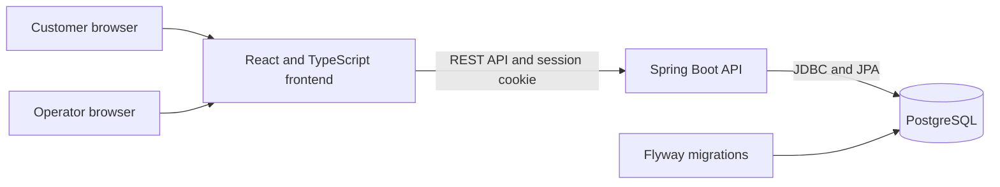

# BiteMap

BiteMap is a food-truck discovery, pickup-ordering, and operations platform built
for the COMP 490/491 senior design sequence. Customers can find trucks that are
currently serving, view menus, place pickup orders, and follow order status.
Operators can manage their trucks, menus, schedules, and incoming orders from a
separate workspace.

The current application supports a complete database-backed workflow:

```text
Discover a truck → choose an active pickup stop → add food → sign in →
place an order → operator processes it → customer sees the updated status
```

## Features

### Customer experience

- Browse and search food trucks without an account.
- Filter discovery results by truck, category, location, and serving schedule.
- View truck profiles, menus, availability, and active pickup locations.
- Add items from one truck to a browser cart.
- Register or sign in without losing the cart.
- Place a pay-at-pickup order at a valid active stop.
- View order confirmation, saved pickup details, history, and current status.

### Operator experience

- Register, sign in, and apply for owner access.
- Manage multiple owned food trucks from one account.
- Create and update truck profiles and menu items.
- Mark menu items active, sold out, or inactive.
- Publish and manage serving schedules.
- Review orders for an owned truck.
- Move orders through `PLACED`, `ACCEPTED`, `READY`, and `COMPLETED`, or cancel
  an eligible order with a reason.
- View private truck-level operational information.

### Platform behavior

- PostgreSQL stores accounts, roles, trucks, menus, schedules, and orders.
- Flyway applies versioned database migrations.
- Server-side validation controls menu prices, availability, pickup stops, and
  order totals.
- Order records preserve item names, prices, and pickup locations as snapshots.
- Idempotency keys prevent duplicate orders after retries.
- Optimistic versioning prevents stale operator updates from overwriting newer data.
- Ownership checks keep one operator from accessing another operator's trucks.
- Session authentication, CSRF protection, and PBKDF2 password hashing protect
  account operations.
- Shared PostgreSQL rate limits protect login and registration, with retry
  countdowns in the UI. See [authentication rate limiting](docs/authentication-rate-limiting.md)
  for policies, deployment requirements, and tests.

## Technology

| Area | Tools |
| --- | --- |
| Frontend | React 19, TypeScript, Vite, React Router |
| Backend | Java 21, Spring Boot, Spring Security, Spring MVC |
| Database | PostgreSQL 15, Flyway |
| Development | Docker Compose, Swagger UI, DBeaver |
| Testing | Vitest, Testing Library, JUnit, MockMvc |
| Workflow | GitHub Actions, pull requests, Jira |

## Architecture



The Vite development server proxies `/api` requests to Spring Boot. The backend
handles identity, authorization, validation, and database transactions. Docker
Compose starts the frontend, backend, and PostgreSQL together.

## Quick start with Docker

### Requirements

- Git
- Docker Desktop with Docker Compose v2

Java, Node.js, Maven, and PostgreSQL do not need to be installed on the host for
this setup.

### 1. Clone the repository

```bash
git clone https://github.com/BiteMap-Project/BiteMap-FoodTruck.git
cd BiteMap-FoodTruck
```

### 2. Create the local environment file

On macOS or Linux:

```bash
cp -n compose.env.example .env
```

On Windows PowerShell:

```powershell
Copy-Item compose.env.example .env
```

Open `.env` and set `COMPOSE_DB_PASSWORD` to a local development password. Do
not commit `.env` or share its contents.

### 3. Start the application

```bash
docker compose up --build -d --wait
```

Open:

- Application: [http://localhost:5173](http://localhost:5173)
- Backend health: [http://localhost:8080/actuator/health](http://localhost:8080/actuator/health)
- Swagger UI: [http://localhost:8080/swagger-ui/index.html](http://localhost:8080/swagger-ui/index.html)

Docker Compose enables the development profile, which loads fictional demo data
and rolling serving schedules. Local ports can be changed with `FRONTEND_PORT`
and `BACKEND_PORT` in `.env`.

### 4. Check or stop the services

```bash
docker compose ps
docker compose logs -f backend
docker compose down
```

The PostgreSQL volume is preserved across normal stops and rebuilds. Do not use
`docker compose down --volumes` unless you intend to permanently delete the local
database.

## Demo workflow

Use two browser sessions so the customer and operator remain signed in separately.

1. Open the homepage as a customer and select a truck with an active stop.
2. Open its menu and add an available item to the cart.
3. Register or sign in, then place the pickup order.
4. Record the order number and its initial `PLACED` status.
5. Sign in as the truck owner in the second browser session.
6. Open the truck's **Orders** tab and find the same order.
7. Change it to `ACCEPTED`, then `READY`.
8. Refresh the customer order page and confirm that the status changed.
9. Mark the order `COMPLETED` and verify the final status in customer history.

## Testing

The current verified baseline on `main` is:

- 205 frontend tests passing.
- 316 backend tests passing.
- Frontend lint and production build passing, with one warning in the legacy
  owner-dashboard prototype.

Run frontend checks:

```bash
cd frontend
npm ci
npm run lint
npm test
npm run build
```

Backend tests require a dedicated PostgreSQL test database and the `DB_URL`,
`DB_USERNAME`, and `DB_PASSWORD` environment variables:

```bash
cd Backend
./mvnw verify
```

GitHub Actions runs the frontend and backend checks for pull requests targeting
`main` and for pushes to `main`. See [.github/workflows/ci.yml](.github/workflows/ci.yml).

## Database and DBeaver

Docker publishes PostgreSQL only to the local computer.

| Setting | Value |
| --- | --- |
| Host | `127.0.0.1` |
| Port | `5433` |
| Database | `bitemap` |
| Username | `bitemap` |
| Password | `COMPOSE_DB_PASSWORD` from the local `.env` |

In DBeaver, expand `bitemap` → **Schemas** → **public** → **Tables**. Changing
the password in `.env` does not change the password of an existing PostgreSQL
volume. Use the password that initialized that volume.

Flyway is the only schema-initialization mechanism. Do not edit an applied
migration. Add a new versioned migration for every schema change. The complete
database workflow is documented in [docs/database-migrations.md](docs/database-migrations.md).

## API documentation

Swagger UI is available only in the local development profile. For authenticated
requests, first execute `GET /api/auth/csrf`, authorize Swagger with the returned
token, and then register or sign in within the same browser session.

Useful documentation:

- [Vendor discovery API](docs/vendor-api.md)
- [Active-stop pickup ordering](docs/active-stop-pickup.md)
- [Customer cart](docs/customer-cart.md)
- [Customer order status](docs/customer-order-status.md)
- [Operator vendors](docs/operator-vendors.md)
- [Operator menus](docs/operator-menu.md)
- [Operator schedules](docs/operator-schedules.md)
- [Operator orders](docs/operator-orders.md)
- [Unified accounts](docs/unified-accounts.md)
- [Owner approval](docs/owner-approval.md)

## Repository structure

```text
BiteMap-FoodTruck/
├── frontend/              React and TypeScript application
├── Backend/               Spring Boot application and database migrations
├── docs/                  Feature contracts, setup notes, and test plans
├── .github/workflows/     Continuous-integration configuration
├── docker-compose.yml     Local three-service environment
└── compose.env.example    Safe Docker environment template
```

## Manual development

For development without Docker, install Java 21, Node.js, and PostgreSQL 15.
Create a local `.env` from `.env.example`, configure `DB_URL`, `DB_USERNAME`, and
`DB_PASSWORD`, and load those variables before starting Spring Boot. Without the
`dev` profile, also set `AUTH_RATE_LIMIT_SECRET` to a randomly generated secret
of at least 32 characters (for example, generate it with `openssl rand -hex 32`).
Use the same secret across backend instances and never commit it. The local
Compose development profile supplies a development-only fallback key.

Start Spring Boot after loading the variables:

```bash
set -a
source .env
set +a
cd Backend
./mvnw spring-boot:run
```

In another terminal:

```bash
cd frontend
npm ci
npm run dev
```

Spring Boot does not load `.env` automatically. IDE run configurations must also
receive the database environment variables.

## Current scope and next phase

COMP 490 established the connected customer-to-operator workflow, database
schema, account roles, truck and menu management, schedules, pickup validation,
ordering, and status tracking.

The next phase can focus on:

- Browser-level end-to-end testing.
- Accessibility and mobile layout improvements.
- Customer cancellation before operator acceptance.
- Customer favorites and account settings.
- Operator controls for pausing new orders.
- Order-status notifications.
- Hosted staging and production configuration.
- Preparation estimates and expanded operator analytics.

Online payment is outside the current scope. Orders are paid at pickup. Serving
schedules describe published availability and do not claim verified live GPS.

## Contributing

Create a feature branch, reference the Jira key in commits and pull requests, and
request a teammate review before merging into `main`.

Before committing:

```bash
git status
git diff --cached
```

Commit source files, migrations, tests, and documentation. Do not commit `.env`,
credentials, build output, IDE settings, or generated logs.
